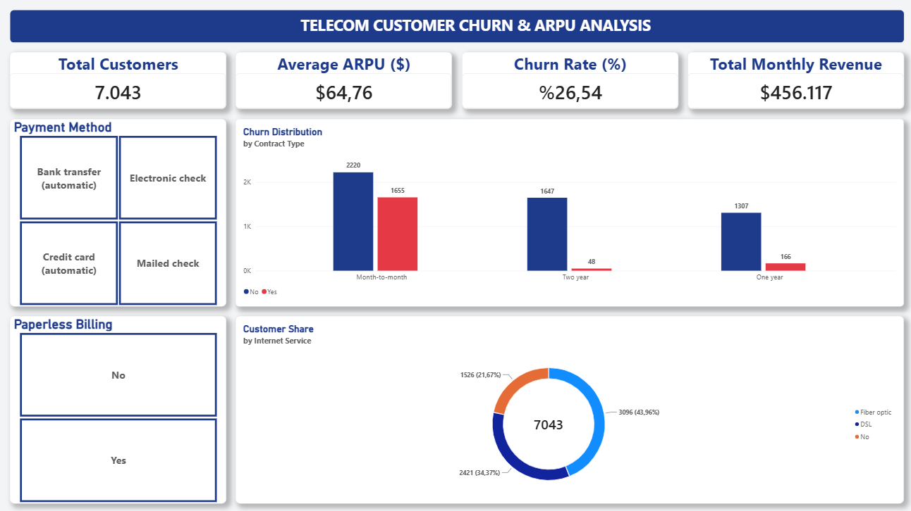

# Telekomünikasyon Müşteri Kaybı (Churn) ve ARPU Analizi | Power BI & SQL

IBM Telco Customer Churn veri setine ait 7.043 müşteri kaydı üzerinden abonelik iptal (Churn) oranları, müşteri başına ortalama gelir (ARPU) ve kullanıcı davranışları analiz edilmiştir.

## 🛠️ Teknik Süreç ve Yöntem

- **SQL Server:** Veri seti veritabanına aktarıldı, ilişkisel tablo yapısı kurgulandı ve temel doğrulama sorguları çalıştırıldı.
- **Power Query:** Veri tipleri dönüştürüldü, bölgesel format (Locale) uyumsuzlukları giderilerek veri temizliği sağlandı.
- **DAX:** Churn Oranı (%), Müşteri Sayısı ve ARPU gibi dinamik metrikler için özel ölçüler (Measures) oluşturuldu.
- **Power BI Dashboard:** Executive seviyede, 1920x1080 (Full HD) çözünürlükte, kart düzeni mimarisine sahip etkileşimli bir pano tasarlandı.

## 📊 Öne Çıkan Analiz Sonuçları

- Genel Churn oranı **%26,54**, ortalama aylık abonelik geliri (**ARPU**) **$64,76**'dır.
- Müşteri kaybının en yoğun olduğu alanlar **Aylık (Month-to-month)** sözleşmeli ve **Fiber Optik** altyapısını kullanan abonelerdir.

---
`#PowerBI` `#SQL` `#DataAnalytics` `#BusinessIntelligence` `#DAX` `#PowerQuery` `#IBM`

